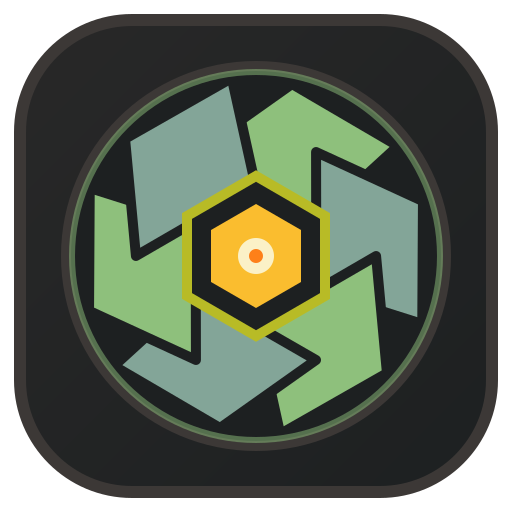

<a id="readme-top"></a>

<div align="center">
  <a href="https://ultradesk-rust.pages.dev/">
    
  </a>

  <h2 align="center">UltraDesk</h2>

  <p align="center">
    <b>A fast, lightweight remote desktop client and host for Linux and macOS</b>
    <br />
    <a href="https://ultradesk-rust.pages.dev/"><strong>Discover the package repository »</strong></a>
    <br />
    <br />
    <a href="https://github.com/dtrh95/ultradesk/releases">
      
    </a>
    <a href="https://github.com/dtrh95/ultradesk/blob/main/LICENSE">
      
    </a>
    <a href="https://ultradesk-rust.pages.dev/">
      
    </a>
    <a href="https://github.com/dtrh95/ultradesk/stargazers">
      
    </a>
    <a href="https://github.com/dtrh95/ultradesk/network/members">
      
    </a>
    <a href="https://github.com/dtrh95/ultradesk/issues">
      
    </a>
    <a href="https://deepwiki.com/dtrh95/ultradesk"></a>
  </p>

  <p align="center">
    <a href="#installation--usage-guide"><strong>Installation »</strong></a>
    <br />
    <br />
    <a href="https://github.com/dtrh95/ultradesk/issues/new?template=bug_report.yml">Report Bug</a>
    &middot;
    <a href="https://github.com/dtrh95/ultradesk/issues/new?template=feature_request.yml">Request Feature</a>
  </p>
</div>

<br />

**UltraDesk** (`ultradesk-rust`) lets you connect to a remote computer or share your screen from one simple desktop app on Linux and macOS. Whether you are helping a friend troubleshoot their computer or accessing your own workstation from afar, UltraDesk gives you a fast, responsive remote session without complicated setup.

### Key Highlights

- **Connect and share in one window**: View and control a remote partner using their 9-digit ID and password, or share your own screen for remote support.
- **Native on Linux and macOS**: Runs smoothly on macOS (Apple Silicon and Intel) as well as Linux desktops (Wayland and X11).
- **Built-in session tools**: Chat in real time, send and receive files, sync clipboards automatically, stream remote desktop audio, and switch between multiple monitors.
- **Built-in AI MCP server**: Let AI assistants (Claude Desktop, Cursor, Claude Code, VS Code) view screenshots, move the mouse, type text, sync clipboards, and transfer files via the Model Context Protocol (`ultradesk-rust mcp` or `ws://127.0.0.1:9333`).
- **Safe by default**: Protects sessions with end-to-end encryption, supports an optional unattended password for personal machines, and blocks repeated failed login attempts.

---

## Installation & Usage Guide

You can install prebuilt packages from the [GitHub Releases](https://github.com/dtrh95/ultradesk/releases) page or directly from the [official package repository](https://ultradesk-rust.pages.dev/).

### 1. macOS (Apple Silicon `M1`/`M2`/`M3`/`M4` & Intel)

#### Install with `.dmg` (Recommended)

1. Download the `.dmg` installer for your Mac from [GitHub Releases](https://github.com/dtrh95/ultradesk/releases):
   - **Apple Silicon (`arm64`)**: `ultradesk-rust-v1.0.2-arm64-macos.dmg`
   - **Intel Mac (`x86_64`)**: `ultradesk-rust-v1.0.2-x86_64-macos.dmg`
2. Open the downloaded `.dmg` file and drag **UltraDesk.app** into your **Applications** folder.
3. On first launch, if macOS displays an unverified developer prompt, run the following command in **Terminal** to clear the quarantine flag and open the app:

```bash
xattr -dr com.apple.quarantine /Applications/UltraDesk.app
open /Applications/UltraDesk.app
```

> **Note for macOS screen sharing**: When you share your Mac screen, macOS will ask you to allow **Screen Recording** (to view your display) and **Accessibility** (to let your partner move the mouse and type) under `System Settings -> Privacy & Security`.

---

### 2. Ubuntu, Debian, Linux Mint, and Pop!_OS

#### Option A: Install via official APT repository (Recommended for automatic updates)

```bash
CODENAME=$(. /etc/os-release && echo "${UBUNTU_CODENAME:-${VERSION_CODENAME:-noble}}")
sudo install -d -m 0755 /etc/apt/keyrings
curl -fsSL https://ultradesk-rust.pages.dev/pubkey.gpg | sudo tee /etc/apt/keyrings/ultradesk-rust.asc >/dev/null
echo "deb [arch=amd64 signed-by=/etc/apt/keyrings/ultradesk-rust.asc] https://ultradesk-rust.pages.dev/apt/${CODENAME} ${CODENAME} main" | sudo tee /etc/apt/sources.list.d/ultradesk-rust.list >/dev/null
sudo apt update
sudo apt install -y ultradesk-rust
```

#### Option B: Install `.deb` package from GitHub Releases

```bash
CODENAME=$(. /etc/os-release && echo "${UBUNTU_CODENAME:-${VERSION_CODENAME:-bookworm}}")
curl -fLO "https://github.com/dtrh95/ultradesk/releases/latest/download/ultradesk-rust_1.0.2-1_amd64_${CODENAME}.deb"
sudo apt install -y "./ultradesk-rust_1.0.2-1_amd64_${CODENAME}.deb"
```

---

### 3. Fedora, RHEL, AlmaLinux, and Rocky Linux

```bash
RELEASEVER=$(rpm -E %fedora)
sudo dnf install -y "https://github.com/dtrh95/ultradesk/releases/latest/download/ultradesk-rust-1.0.2-1.fc${RELEASEVER}.x86_64.${RELEASEVER}.rpm"
```

---

### 4. openSUSE Tumbleweed and Leap

```bash
sudo zypper install -y "https://github.com/dtrh95/ultradesk/releases/latest/download/ultradesk-rust-1.0.2-1.x86_64.tumbleweed.rpm"
```

---

### 5. Arch Linux, Manjaro, and EndeavourOS

```bash
curl -fLO "https://github.com/dtrh95/ultradesk/releases/latest/download/ultradesk-rust-v1.0.2-x86_64-archlinux.tar.zst"
sudo pacman -S --needed --noconfirm openssl libxcb zstd gtk3 webkit2gtk-4.1 libsoup3
sudo tar --zstd -xvf ultradesk-rust-v1.0.2-x86_64-archlinux.tar.zst -C /
```

---

### 6. NixOS and Nix Flakes

Run directly with Nix Flakes:

```bash
nix run github:dtrh95/ultradesk#ultradesk-rust-head
```

---

### Quick Start

1. **Launch UltraDesk** from your application menu or run `ultradesk-rust` in a terminal.
2. **To control a remote computer**: Enter your partner's 9-digit **Partner ID** and **Password**, then click **Connect**.
3. **To let someone control your computer**: Share your **My ID** and temporary **Password** shown in the app. You can also set a permanent password in the app settings for unattended access.
4. **Switching monitors**: Use the top toolbar inside an active session to view all displays (`ALL`) or focus on a specific monitor (`M1`, `M2`).

> **Note for Linux Wayland users**: To allow a remote partner to control your mouse and keyboard on Wayland, grant your user account access to `/dev/uinput`:
> ```bash
> sudo modprobe uinput
> sudo setfacl -m u:$USER:rw /dev/uinput
> ```

---

### AI Assistant Integration (Built-in MCP Server)

UltraDesk includes a native **Model Context Protocol (MCP)** server so AI agents (such as **Claude Desktop**, **Cursor**, **Claude Code**, and **OpenCode**) can take screenshots, click, type Unicode text, manage clipboards, and transfer files on remote or local desktops.

#### Option A: Connect via `stdio` (Claude Desktop, Cursor, Claude Code)

Add `ultradesk` to your MCP configuration (`~/.cursor/mcp.json`, `.mcp.json`, or `claude_desktop_config.json`):

```json
{
  "mcpServers": {
    "ultradesk": {
      "command": "ultradesk-rust",
      "args": ["mcp"]
    }
  }
}
```

#### Option B: Run the local WebSocket & HTTP MCP server (`127.0.0.1:9333`)

Launch UltraDesk with the `--mcp` flag (or run `ultradesk-rust mcp --ws`) to start the local JSON-RPC 2.0 MCP listener on `ws://127.0.0.1:9333` and `http://127.0.0.1:9333/mcp`:

```bash
ultradesk-rust --mcp --mcp-token your-secret-token
```

---

## Compilation from source (for developers)

If you want to compile UltraDesk from source to contribute or customize:

### Dependencies

- **Debian/Ubuntu:** `sudo apt-get install -y build-essential cargo rustc pkg-config libssl-dev libxcb1-dev libxcb-shm0-dev libxcb-randr0-dev libx11-dev libxtst-dev libzstd-dev libgtk-3-dev libwebkit2gtk-4.1-dev libsoup-3.0-dev`
- **Fedora/RHEL:** `sudo dnf install -y cargo rust pkgconf-pkg-config openssl-devel libxcb-devel libX11-devel libXtst-devel libXrandr-devel libzstd-devel gtk3-devel webkit2gtk4.1-devel libsoup3-devel`
- **openSUSE:** `sudo zypper install -y cargo rust pkg-config libopenssl-devel libxcb-devel libX11-devel libXtst-devel libXrandr-devel libzstd-devel gtk3-devel webkit2gtk3-devel libsoup-devel`
- **Arch:** `sudo pacman -S --needed base-devel rust pkgconf openssl libxcb libx11 libxtst libxrandr zstd gtk3 webkit2gtk-4.1 libsoup3`
- **macOS:** `xcode-select --install` and install Rust via [rustup.rs](https://rustup.rs/)

### Install

```bash
git clone https://github.com/dtrh95/ultradesk.git
cd ultradesk
make build
sudo make install PREFIX=/usr
```

On macOS, you can package a standalone `UltraDesk.app` and `.dmg` installer:

```bash
ARCH=$(uname -m)
TARGET=$(rustc -vV | sed -n 's/host: //p')
cargo build --release --target "${TARGET}"
./packaging/macos/package-macos.sh "${TARGET}" "${ARCH}" "v1.0.2"
```

---

<a id="contributing"></a>

## 🤝 Contributing

Contributions are what make the open-source community such an amazing place to learn, inspire, and create. Any contribution you make is **greatly appreciated**.

Please see the detailed guide [here](CONTRIBUTING.md) for how to participate in project development, the Pull Request process, [code style rules](CODE_STYLE.md), and the [code of conduct](CODE_OF_CONDUCT.md).

Don't forget to give the project a ⭐! Thank you very much!

---

<a id="license"></a>

## 📃 License

This project is distributed under the terms of the **MIT License**. See [`LICENSE`](LICENSE) for details.

Third-party libraries retain their original licenses and copyrights. Full attributions and trademark notices are available in [`THIRD_PARTY_NOTICES.md`](THIRD_PARTY_NOTICES.md).

---

## Contributors ✨

Thanks goes to these wonderful people ([emoji key](https://allcontributors.org/en/reference/emoji-key)):

<!-- ALL-CONTRIBUTORS-LIST:START - Do not remove or modify this section -->
<!-- prettier-ignore-start -->
<!-- markdownlint-disable -->
<table>
  <tbody>
    <tr>
      <td align="center" valign="top" width="25%"><a href="https://github.com/dtrh95"><br /><sub><b>dtrh95</b></sub></a><br /><a href="https://github.com/dtrh95/ultradesk/commits?author=dtrh95" title="Code">💻</a> <a href="https://github.com/dtrh95/ultradesk/commits?author=dtrh95" title="Documentation">📖</a> <a href="#platform-dtrh95" title="Packaging/porting to new platform">📦</a> <a href="#projectManagement-dtrh95" title="Project Management">📆</a></td>
    </tr>
  </tbody>
</table>

<!-- markdownlint-restore -->
<!-- prettier-ignore-end -->

<!-- ALL-CONTRIBUTORS-LIST:END -->

This project follows the [all-contributors](https://github.com/all-contributors/all-contributors) specification. Contributions of any kind welcome!

---

## ✨ Star History

<a href="https://github.com/dtrh95/ultradesk">
  
</a>
